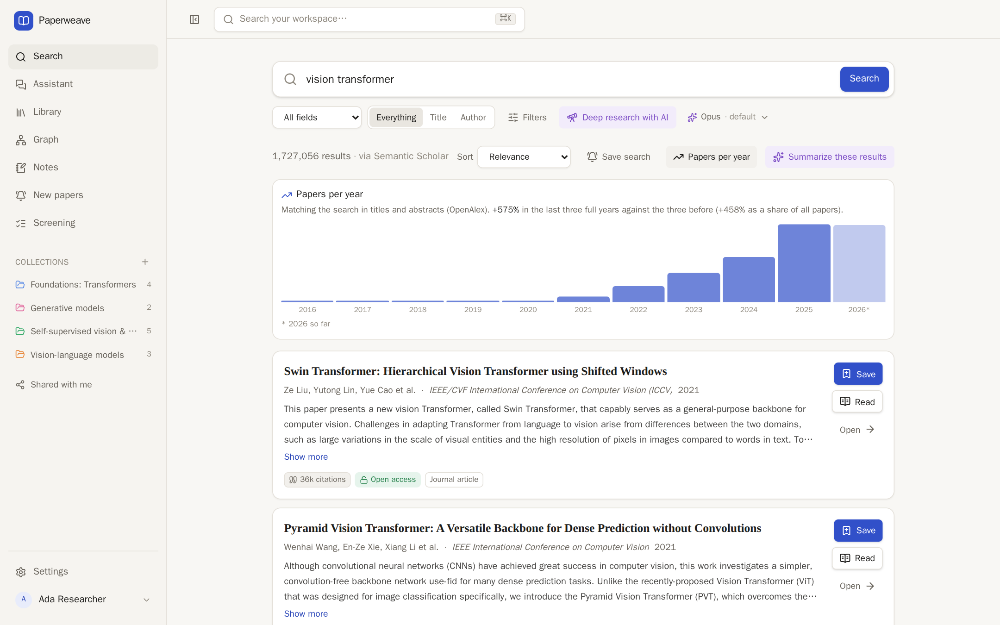
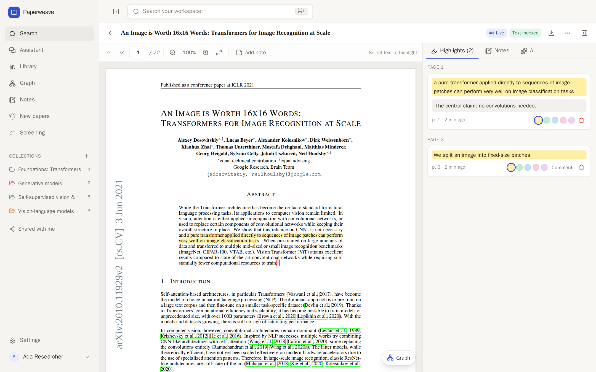
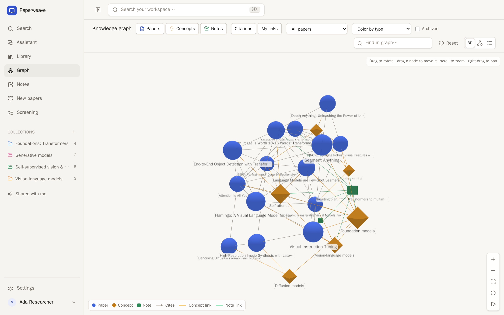
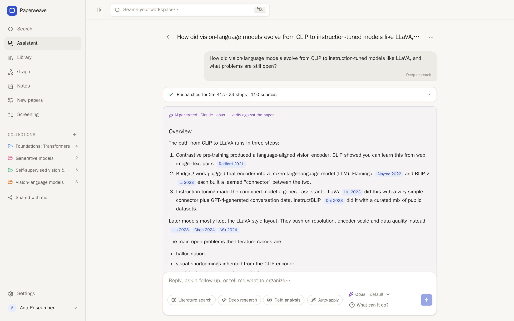

# Paperweave

A research knowledge workspace for scientific papers. Find the important papers on a topic, follow the work
that came before and after them, read and annotate PDFs, take linked notes, and see how everything connects —
with or without AI.



```
Research question → discover papers → evaluate → explore lineage → read → understand
        ↑                                                                   ↓
   discover more  ←  search your knowledge  ←  connect ideas  ←  take notes
```

## A quick look

**Read and annotate.** Open-access PDFs open in the built-in reader. Highlight and comment, write notes beside
the paper, and follow its citations without leaving the page.



**See how it connects.** Your papers, concepts and notes as one graph, with citations between papers and the
links you made yourself.



**Ask the assistant (optional).** It searches your library and the literature, reads the papers that matter
and writes a cited report — every step is shown, and every claim links to its source.



<sub>Screenshots show a demo workspace of well-known papers.</sub>

## Features

- **Scholarly search** — real literature from Semantic Scholar and OpenAlex (with automatic failover),
  enriched with Crossref and arXiv, plus a **Biomedical** source (Europe PMC: PubMed, PubMed Central,
  bioRxiv/medRxiv) and an **ML venues** source (OpenReview: ICLR, NeurIPS, ICML…). Search by keywords, title,
  author, a natural-language question, DOI, arXiv id or link. Filter by year, citations, venue, type and open
  access; sort by relevance, newest (including the latest arXiv preprints) or most cited.
- **Citations and lineage** — references and citing papers with citation contexts and intents, and an
  interactive explorer of earlier and later work.
- **Library** — reading status, tags, collections, bulk actions, BibTeX export.
- **PDF reader** — legal open-access PDFs (arXiv, publishers and repositories via Unpaywall, OpenReview),
  uploads or links. Free PDFs are read live from their source and follow new versions (highlights move with
  them). Highlights, comments, page notes and a side panel for the paper's notes.
- **Notes and concepts** — block-based notes (type `/`), `[[links]]` to papers, concepts and other notes,
  backlinks; concepts as lightweight knowledge nodes that connect papers.
- **Knowledge graph** — your papers, concepts and notes in 3D or 2D, citation edges distinct from your own links.
- **Workspace search** — ⌘K / Ctrl-K over papers, notes, concepts, highlights and PDF full text.
- **New papers and screening** — saved searches that run daily and list what is new; screen up to 500 papers
  against inclusion / exclusion criteria with AI, systematic-review style.
- **Sharing, import and export** — share collections, notes and concepts (view / edit / public link); import
  BibTeX (Zotero, Mendeley…) or lists of DOIs; export JSON, an Obsidian-compatible Markdown vault, or BibTeX.
- **AI assistant (optional)** — a chat that uses your library, notes and highlights, reads papers, searches
  the literature, writes cited reports, compares papers with page references, looks at figures, and proposes
  changes to your workspace (collections, tags, concepts, notes, highlights) that you apply and can undo.
  Bring your own model: your Claude or ChatGPT subscription (via the Claude Code / Codex CLIs), Anthropic,
  OpenAI, any OpenAI-compatible API, or a model running on your own computer.
- **Works without AI** — every core feature works with no AI configured.

## Quick start

Requirements: **Node.js 20.9+** (24 recommended) and **Docker** with Compose.

```bash
git clone https://github.com/Hugin373/paperweave.git && cd paperweave
cp .env.example .env            # set BETTER_AUTH_SECRET and APP_ENCRYPTION_KEY: openssl rand -base64 32
docker compose up -d            # PostgreSQL (:5433) and S3-compatible storage (:8333)
npm install
npm run db:migrate
npm run dev                     # http://localhost:3300 — create your account on the sign-up page
```

For everyday use run the production build instead, which is much faster: `npm run build && npm start`.

> **Get free API keys for the scholarly sources.** Without keys, OpenAlex allows only a small daily budget
> shared per IP address and Semantic Scholar's shared pool is often rate limited. Get an
> [OpenAlex key](https://help.openalex.org/api/authentication/) (`OPENALEX_API_KEY`) and a
> [Semantic Scholar key](https://www.semanticscholar.org/product/api) (`SEMANTIC_SCHOLAR_API_KEY`), and set
> `SCHOLARLY_CONTACT_EMAIL` (needed to find free PDFs through Unpaywall).

## Ways to run it

| Setup                             | What it is                                                                                 | Guide                                                          |
| --------------------------------- | ------------------------------------------------------------------------------------------ | -------------------------------------------------------------- |
| **One computer + Tailscale**      | Everything on one computer; phone, tablet and other computers open it over Tailscale.      | [SETUP.md › One computer](SETUP.md#one-computer--tailscale)    |
| **Several computers, cloud data** | Each computer runs Paperweave against a shared cloud database (Neon) and PDF storage (R2). | [SETUP.md › Cloud data](SETUP.md#several-computers-cloud-data) |
| **Server** (several users)        | Docker Compose or a container image behind HTTPS.                                          | [SETUP.md › Server](SETUP.md#server-deployment)                |

Backups (`npm run backup`), updating and restoring are covered in [SETUP.md](SETUP.md#backups).

## Configuration

All settings are environment variables in `.env`; [`.env.example`](.env.example) documents every one. The
main ones:

| Variable                                                                  | Purpose                                                                               |
| ------------------------------------------------------------------------- | ------------------------------------------------------------------------------------- |
| `APP_URL`, `TRUSTED_ORIGINS`                                              | The address Paperweave is opened at, and other addresses (e.g. a Tailscale URL).      |
| `DATABASE_URL`                                                            | PostgreSQL 15+ connection string.                                                     |
| `BETTER_AUTH_SECRET`, `APP_ENCRYPTION_KEY`                                | Sign-in sessions; encryption of stored AI API keys. Keep them secret and backed up.   |
| `STORAGE_DRIVER` (`s3` / `local`), `S3_*`, `STORAGE_LOCAL_DIR`            | Where uploaded and kept PDFs are stored.                                              |
| `SEMANTIC_SCHOLAR_API_KEY`, `OPENALEX_API_KEY`, `SCHOLARLY_CONTACT_EMAIL` | Scholarly sources (recommended).                                                      |
| `OPENREVIEW_USERNAME`, `OPENREVIEW_PASSWORD`                              | Optional: reviews, decisions and submission PDFs from OpenReview.                     |
| `ALLOW_REGISTRATION`                                                      | `false` closes sign-up once your account exists.                                      |
| `SINGLE_USER_EMAIL`                                                       | Single-user mode: no sign-in page (only for an instance nobody else can reach).       |
| `AI_ENABLE_SUBSCRIPTION_CLI`                                              | Allow the Claude / ChatGPT subscription providers under `npm start` (local use only). |

## AI providers

Open **Settings → AI**, pick a provider and model, add an API key if needed, then **Test connection**. Keys
are encrypted at rest and never sent back to the browser. A model picker next to each AI feature switches
model and effort on the fly.

| Provider                              | Setup                                                                                                                          |
| ------------------------------------- | ------------------------------------------------------------------------------------------------------------------------------ |
| Claude subscription (via Claude Code) | Install [Claude Code](https://claude.com/claude-code) on the computer running Paperweave and sign in.                          |
| ChatGPT subscription (via Codex)      | Install the [Codex CLI](https://developers.openai.com/codex/cli) and run `codex login`.                                        |
| Anthropic / OpenAI                    | An API key from [console.anthropic.com](https://console.anthropic.com/) / [platform.openai.com](https://platform.openai.com/). |
| OpenAI-compatible API                 | A hosted service's base URL with the API prefix (OpenRouter, Together, Groq…), model id and key.                               |
| Local model                           | Any model server on your computer or network that speaks the OpenAI chat API. See [SETUP.md](SETUP.md#local-model).            |

The subscription providers run the official CLIs non-interactively in an empty folder with no tools (Claude
Code) or a read-only sandbox (Codex); your login never leaves the CLI. They are meant for your own use only —
everyone who can reach the server would use your plan. Answers about a paper are grounded in its full text
when one can be read, and everything AI-generated is labeled.

## Development

```bash
npm run typecheck && npm run lint && npm test   # needs `docker compose up -d`
npm run test:e2e                                # Playwright in Docker, against a separate database
```

Server logic lives in `src/server/**` (services take a workspace id), route handlers in `src/app/api/**` stay
thin, and client code never imports `src/server`. Migrations are in `drizzle/` (`npm run db:generate`, then
`npm run db:migrate`).

Built with Next.js 16 (App Router, React 19) · TypeScript · PostgreSQL + Drizzle ORM · Better Auth ·
S3-compatible storage · pdf.js · TipTap · TanStack Query · Tailwind CSS 4 · Radix UI · Vitest · Playwright.

## License

[MIT](LICENSE)
